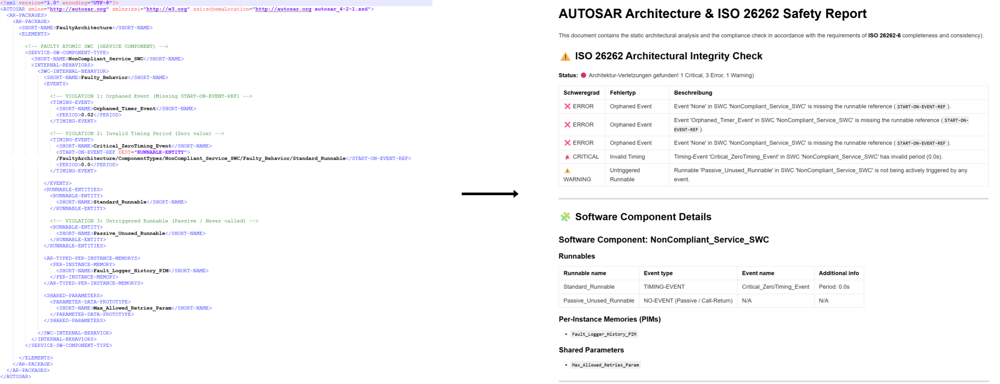

# 🙋‍♀️ "Mom, what do you actually do at work?"

My children have asked me this many times. To be honest, the answer isn't as simple as "I’m a baker, I bake bread." Usually, I stumble through an explanation about writing computer programs that make cars safe.

While that’s a decent high-level summary, it doesn't really show what I’m doing at my desk all day. This project is my attempt to bridge that gap.

Here, I explain in plain language what a software engineer in the automotive industry actually does. We’ll explore:

- **Who actually tells the car what to do?** (The car, its ECUs and BUS system).
- **Who decides which commands the car has to follow?** (The importance of ISO 26262).
- **How do you write millions of commands without making any mistakes?** (Model-Based Design explained).
- **How do you prevent a huge mess with so many messages?** (From ARXML to actual driving).
  
# 🚀 The Vision: Automating Safety Compliance

While the story starts with a simple question, the technical core of this project is solving a real-world engineering pain point: **The manual effort of verifying complex automotive software architectures.**

This repository is evolving into a **Python-based ARXML Parser** specifically designed to automate ISO 26262 compliance checks. It bridges the gap between high-level Model-Based Design (MBD) and the underlying XML structures that define modern vehicle behavior.

## Pipeline Transformation at a Glance

The compliance engine ingests highly nested, verbose AUTOSAR XML specifications and compiles them into clear, actionable functional safety tracking dashboards.

*Figure: Automated conversion of raw AUTOSAR XML (left) into a standardized ISO 26262 compliance markdown report (right).*

# 🛠️ Project Status (Work in Progress)

I am building this project "in public" using the **Diataxis Framework** to ensure high-quality documentation from day one.

## Documentation (Docs-as-Code)

- [x] **[Explanation for Kids (DE)](docs/explanation-for-kids_DE.md)** – *Peer-reviewed by my 10-year-olds.*
- [x] **[Explanation for Kids (EN)](docs/explanation-for-kids_EN.md)**
- [x] **[Explanation for Specialists (EN)](docs/explanation-for-specialists.md)** – Deep dive into AUTOSAR structures.
- [x] **[Explanation for Testers (EN)](docs/explanation-for-testers.md)** – Explanation of testing philosophy and coverage strategy.
- [x] **[Tutorial](docs/tutorial.md)** – Step-by-step learning guide for execution and verification.
- [x] **[How-To Guide](docs/how-to-guide.md)** – Practical recipes for fault injection and testing.
- [x] **[Reference](docs/reference.md)** – Strict API, CLI, and Exception specifications.

## Engineering & Tooling

- [x] **Core Engine:** Base ARXML Parser (lxml based XPath queries).
- [x] **Safety Rules Engine:** Automated ISO 26262 integrity checks (Orphaned Events & Runnables).
- [x] **Automated Reporting:** Clean Markdown output generation and safety dashboard compilation.
- [x] **Test Harness:** Comprehensive regression suite using `pytest` and custom data samples.
- [ ] **SWC Analyzer:** Deep validation of Software Components and Port Interfaces.
- [ ] **Data Type Checker:** Mapping Application to Implementation levels.

# 💻 Tech Stack

- **Language:** Python 3.10+
- **Parsing:** lxml (for high-performance XPath queries)
- **Documentation:** Markdown & Mermaid.js
- **Methodology:** Diataxis Framework

## 🗺️ Roadmap & Upcoming Features

This project is actively maintained. The following features are planned for future releases to enhance code quality and engineering efficiency:

- [x] Basic ARXML Parsing (SWC Types, Composition Layouts)
- [x] ISO 26262 Structural Integrity Compliance Check (Orphaned Events & Runnables)
- [x] Automated Markdown Report & Dashboard Generation
- [x] **Automated Quality Gate (Unit Tests):** Implemented a robust test suite using `pytest` and custom fault-injection data samples to verify engine accuracy.
- [ ] **AI Documentation Reviewer (`ai_doc_reviewer`):** Integrate a local LLM or API gateway to automatically analyze the generated Markdown reports, providing safety recommendations and checking against detailed ISO 26262 safety goals.
- [ ] **Visual Architecture Export:** Render interactive Mermaid.js diagrams directly within the Markdown report to visualize Composition-to-SWC mapping.

---

# 👩‍🔬 About Me
I am a **Senior Software Engineer & Ph.D. Mathematician** with 8+ years of experience in the automotive industry. I specialize in architecting automated toolchains and ensuring functional safety (ISO 26262) without slowing down the development process.