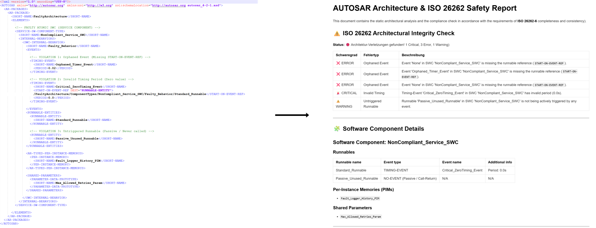

# ISO 26262 ARXML Parser

[](https://github.com/katrintalkenberger/iso26262-arxml-parser/actions/workflows/tests.yml)

A Python tool that reads AUTOSAR XML (ARXML) files and runs structural consistency checks on software components. The checks support the verification of the software architectural design according to ISO 26262-6. They do not replace a safety assessment.

The parser loads the ARXML file, extracts software components, events, runnables, per-instance memories and shared parameters, and writes a Markdown report with all findings and their severity.


*Figure: ARXML input (left) and generated Markdown report (right).*

## Quick start

```bash
git clone https://github.com/katrintalkenberger/iso26262-arxml-parser
cd iso26262-arxml-parser
pip install -r requirements.txt
python -m src.main tests/samples/ISO26262_Violations_Sample.arxml
```

## Documentation

The documentation is organized in four parts:

- **Tutorials**
  - [Getting started](docs/tutorials/getting-started.md): Run the parser for the first time on the sample files.
- **How-to guides**
  - [Inject architecture faults](docs/how-to/inject-architecture-faults.md): Modify an ARXML file to trigger each check.
- **Reference**
  - [CLI](docs/reference/cli.md): Command syntax, arguments and output location.
  - [API](docs/reference/api.md): Classes, methods and exceptions of the parser.
  - [Check catalog](docs/reference/checks.md) *(in progress)*: Consistency checks with severity and ISO 26262-6 references.
- **Explanation**
  - [Car software safety for kids (EN)](docs/explanation/car-software-safety-for-kids_EN.md) / [(DE)](docs/explanation/car-software-safety-for-kids_DE.md): Car software and functional safety for a non-technical audience. *Peer-reviewed by my 10-year-olds.*
  - [AUTOSAR ARXML structure](docs/explanation/autosar-arxml-structure.md): Structure of AUTOSAR XML files, for AUTOSAR developers.
  - [Testing strategy](docs/explanation/testing-strategy.md): Testing approach and coverage, for testers and reviewers.

## Project status

- [x] ARXML parsing of software component types and compositions
- [x] Consistency checks: orphaned events, invalid timing periods, untriggered runnables
- [x] Markdown report generation
- [x] Unit tests with fault-injection samples, CI on Python 3.11 to 3.14
- [ ] Check catalog with ISO 26262-6 references
- [ ] SWC analyzer: port interfaces and connections
- [ ] Data type checker: application to implementation data type mapping
- [ ] AI-assisted report review: summarize findings and point to relevant sections of the check catalog
- [ ] Mermaid diagrams of the composition-to-SWC mapping in the report

## Contributing and license

Guidelines for contributions are in [CONTRIBUTING.md](CONTRIBUTING.md). 

The ARXML parser is released under the [MIT license](LICENSE).

---

## About me

I am a software engineer with a Ph.D. in mathematics and 8+ years in automotive software. I develop MBD toolchains and verification automation (Simulink, Model Advisor checks, ARXML parsers) and have contributed to safety-related projects under ISO 26262 up to ASIL B. [LinkedIn](https://www.linkedin.com/in/katrintalkenberger/)