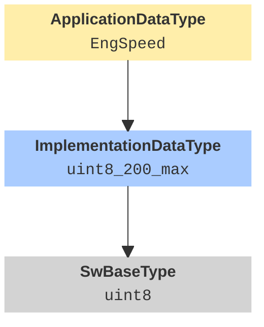

# Deep Dive: Structural analysis of AUTOSAR XML Schema (R4.x)

## Architectural Overview

The standard AUTOSAR XML file, or short ARXML, is simply a regular XML file with the file extension *.arxml. The root element is always `<AUTOSAR>` and contains:  

- `<AR-PACKAGES>`: AUTOSAR package container (wrapper element), which contains one or more `<AR-PACKAGE>` elements.
- `<AR-PACKAGE>`: AUTOSAR package, which can recursively contain an `<AR-PACKAGES>` element (hierarchical structure).

Each AUTOSAR package `<AR-PACKAGE>` is identified by its name attribute `<SHORT-NAME>`. Inside the AUTOSAR package, `<ELEMENTS>` contain specific AUTOSAR category elements, such as components, constants, data types, modes, ports and port interfaces.

If we take a step back from the ARXML, we can abstract the following structure:

```
AUTOSAR (root)
├── 🧩 Software Component 
│   ├── ComponentType (software component logic and behavior)
│   └── PortInterfaces (communication from/to software component)
├── 📖 Data Dictionary
│   ├── DataTypes (data types at application and implementation level)
│   └── DataTypeMappingSets (mapping between application and implementation data types)
└── ⚙️ Physical Properties
    ├── CompuMethods (data type scaling  and units)
    ├── DataConstrs (data type limits and constraints)
    └── Units (data type physical units)
```


## 🧩 Software Component (SWC)

### Software Component Types
A software component (SWC) is a modular, reusable unit of functionality in the application layer of the AUTOSAR architecture. There are different types of SWC:

| 📋 Name | 🏷️ XML Tag | 📝 Description | 🎯 Safety Check
| ----- | ----- | ----- | ----- |
| **Application SWC** | `<APPLICATION-SW-COMPONENT-TYPE>` | The standard component for application logic like cruise control or airbag deployment. It interacts only with **Run-Time Environment (RTE)**, never directly with hardware. | Validation of ASIL-Level.|
| **Complex Device Driver (CDD) SWC** | `<COMPLEX-DEVICE-DRIVER-SW-COMPONENT-TYPE>` | A hardware-dependent component, time critical, without standard interfaces but direct access to hardware/microcontroller, like fast sensor processing. | Analysis of Timing-Constraints. |
| **Composition SWC** | `<COMPOSITION-SW-COMPONENT-TYPE>` | A logical container that groups together several other components. It serves to structure the system and does not have its own implementation (code). | Check of hierarchy. |
| **Service SWC** | `<SERVICE-SW-COMPONENT-TYPE>` | A component for system-wide services of the **Basic Software (BSW)** like diagnostic and NVRAM access. | Monitoring of NVRAM interfaces. |

**Application**, **CDD** and **Service software components** are so called **Atomic software components**. Each Atomic SWC can have internal behavior. A Composition, on the other hand, serves only for logical grouping and therefore has no executable content of its own. 

The following table illustrates which elements each SWC may contain.

| Feature | Application SWC | CDD SWC | Service SWC | Composition SWC |
| ----- | ----- | ----- | ----- | ----- |
| **Ports** | ✅ | ✅ | ✅ | ✅ |
| **Internal Behavior** | ✅ | ✅ | ✅ | ❌ |
| ∟ Events (Timing, Data) | ✅ | ✅ | ✅ | ➖ |
| ∟ Runnables | ✅ | ✅ | ✅ | ➖ |
| ∟ Shared Parameters | ✅ | ✅ | ✅ | ➖ |
| ∟ Per-Instance Memory (PIM) | ✅ | ✅ | ✅ | ➖ |
| ∟ Inter-Runnable Variables (IRV) | ✅ | ✅ | ✅ | ➖ |
| **Data Type Mapping Ref** | ✅ | ✅ | ✅ | ❌ |
| **Direct HW Access** | ❌ | ✅ | ❌ | ❌ |


### Port Interfaces
Following the AUTOSAR standard, SWCs never communicate directly with each other. Instead, communication is organized using port interfaces:

| 📋 Name | 🏷️ XML Tag | 📝 Description | 🎯 Safety Check
| ----- | ----- | ----- | ----- |
| **Sender-Receiver (S/R) Interface** | `<SENDER-RECEIVER-INTERFACE>` | Used when one component sends data and another receives it. Common for transmitting signals like speed, temperature, or pressure. Typically asynchronous. | End-to-End protection (Alive Counter, CRC). |
| **Client-Server (C/S) Interface** | `<CLIENT-SERVER-INTERFACE>` | Enables one component (the client) to call a service or function provided by another component (the server). Often synchronous, can support return values and error codes. | Validation of Error-Codes and Timeout Checks. |
| **Mode-Switch Interface** | `<MODE-SWITCH-INTERFACE>` | Used when a component’s behavior depends on the mode of another component or the system. Enables mode-based design like "normal", "sleep" or "diagnostic" | Validation that switch to Safe-State has top priority. |
| **Parameter Interface** | `<PARAMETER-INTERFACE>` | Used for accessing static or configurable parameters. Common for calibration values or constants. | Verification of parameter range. |
| **NV Data Interface** | `<NV-DATA-INTERFACE>` | Provides access to non-volatile memory (EEPROM/Flash). It allows SWCs to read and write data that must persist even after a power cycle (e.g., odometer readings or error logs). | Integrity check of stored safety-critical data (e.g., ROM/RAM mirroring) and validation of write-access permissions. |


## 📖 Data Dictionary

### Data Types
AUTOSAR divides data types into three levels of abstraction to separate the physical application from the actual memory implementation.

#### 1. Application Data Types
The application data type describes the data type from a physical perspective (e.g. temperature in °C, speed in km/h). It is used at the software architecture level without regard to implementation.

There are three basic application data types

- **Application Primitive Data Type (`APPLICATION-PRIMITIVE-DATA-TYPE`)**: The fundamental building blocks of physical data representation, including single values, binary states, and multi-dimensional lookup structures (Curves/Maps).

    | 📋 Category | 🔗 Type Reference | 🛠️ Specifics | 📝 Description |
    | ----- |  ----- | ----- | ----- |
    | `VALUE` | - | - | Represents a physical quantity (e.g. `°C`, `km/h`). Is considered a primitive data type. |
    | `BOOLEAN` | - | - | Represents a binary state or a flag (e.g. `True`/`False`, `On`/`Off`). Is considered a primitive data type. |
    | `STRING` | `BASE-TYPE-REF` | - | References to a base data type. |
    | `COM_AXIS` | `INPUT-VARIABLE-TYPE-REF` | Dimension: `SW-MAX-AXIS-POINTS`  | Represents an axis for a curve or a map (e.g. engine speed axis). |
    | `CURVE` | `VALUE-AXIS-DATA-TYPE-REF` | Axis: `SHARED-AXIS-TYPE-REF`| Represents a 1D lookup table (e.g. torque over speed). |
    | `MAP` | `VALUE-AXIS-DATA-TYPE-REF` | Axis: `SHARED-AXIS-TYPE-REF` | Represents a 2D lookup table (e.g. fuel injection map). |
    | `CUBOID` | `VALUE-AXIS-DATA-TYPE-REF` | Axis: `SHARED-AXIS-TYPE-REF` | Represents a 3D lookup table. |

- **Application Array Data Type (`APPLICATION-ARRAY-DATA-TYPE`)**: Describes an array of objects of the same type.

    | 📋 Category | 🏗️ Elements | 🔗 Type Reference | 🛠️ Specifics | 📝 Description |
    | ----- | ----- | ----- | ----- | ----- |
    | `ARRAY` | `ELEMENT` | `TYPE-TREF` | Dimension: `MAX-NUMBER-OF-ELEMENTS` | A homogeneous collection of data elements, all sharing the same Application Data Type. |

- **Application Record Data Type (`APPLICATION-RECORD-DATA-TYPE`)**: Describes a complex data type that combines different data types into a single logical unit (similar to a struct in C).

    | 📋 Category | 🏗️ Elements | 🔗 Type Reference | 📝 Description |
    | ----- | ----- | ----- | ----- |
    | `STRUCTURE` | `APPLICATION-RECORD-ELEMENT` | `TYPE-TREF` | A heterogeneous collection of elements (Records) used to group related data into a single logical structure. |


#### 2. Implementation Data Type (`IMPLEMENTATION-DATA-TYPE`)
The implementation data type describes the data type from the perspective of software implementation (e.g., uint16, float32). Used at the software component implementation level (code level).

| 📋 Category | 🏗️ Elements | 🔗 Type Reference | 🛠️ Specifics | 📝 Description |
| ----- | ----- | ----- | ----- | ----- |
| `TYPE_REFERENCE` | - | `IMPLEMENTATION-DATA-TYPE-REF ` | - | Alias/Typedef for reusability. |
| `VALUE` | - | `BASE-TYPE-REF` | - | Scaled integer/float in C-code. References to a base data type. |
| `BOOLEAN` | - | `BASE-TYPE-REF` | - | The logical representation in code. References to a base data type (typically unsigned integer). |
| `STRING` | - | `BASE-TYPE-REF` | - | Fixed or variable length character sequence for code-level processing.  References to a base data type (typically a character base type). |
| `ARRAY` | `IMPLEMENTATION-DATA-TYPE-ELEMENT` | `IMPLEMENTATION-DATA-TYPE-REF` | Dimension: `ARRAY-SIZE` | Fixed-size buffer implementation. |
| `STRUCTURE` | `IMPLEMENTATION-DATA-TYPE-ELEMENT` | `IMPLEMENTATION-DATA-TYPE-REF` | - | C-struct; defines memory layout. |


#### 3. Base Data Type (`SW-BASE-TYPE`)
The base data type represents the fundamental C-primitive data type on the target hardware (e.g. `uint32`, `float64`).

| 📋 Category | 🏗️ Properties | 📝 Description |
| ----- | ----- | ----- |
| `SW-BASE-TYPE` | `BASE-TYPE-SIZE`, `BASE-TYPE-ENCODING` | Defines bit-width (e.g., 8, 16, 32) and alignment. |


### Data Type Mapping Sets 
Die Verbindung zwischen den verschiedenen Abstraktionsebenen der Datentypen erfolgt über ein **Data Type Mapping**. An application data type is mapped to an implementation data dype (`<DATA-TYPE-MAP>`), and the implementation data type can directly relate to ist software base type.




## ⚙️ Physical Properties
In most ARXML descriptions, application data types have software data definition properties that include physical data constraints and computation methods that include units. Implementation data types also have software data definition properties, but they include internal data constraints and references to software base types.

- **Computation Method** (`COMPU-METHODS`)
    Defines the mathematical relationship between the physical value and the internal value (integer/bit pattern).
    - *Categories*: `LINEAR` (Factor/Offset), `BITFIELD-TEXTTABLE` (for status flags), and `SCALE-LINEAR` (for non-linear sensors).
    - *Safety Impact*: Ensuring that scaling overflows are prevented during fixed-point arithmetic.
- *Data Constraint** (`DATA-CONSTR`)
    Specifies the valid range (min/max) for the data.
        - *Physical Constraints*: Limits based on physical reality (e.g., a car cannot have a negative speed).
        - *Internal Constraints*: Limits based on the implementation (e.g., a 12-bit ADC value).
        - *Safety Impact*: These constraints are the foundation for range checks and plausibility checks in ASIL-compliant software.
- **Unit** (`UNITS`)
    Provides the physical unit of measure (e.g. `degC`, `km/h`, `Nm`). While not used for code generation, it is crucial for tool-based documentation and ensuring that different SWCs "speak the same language" (e.g. preventing a torque value in `Nm` from being connected to a port expecting `lb-ft`).


## Further Reading
[AUTOSAR Read the Docs](https://autosar.readthedocs.io/en/latest/basics.html)
[Mastering Software Components in AUTOSAR](https://theautojourney.medium.com/mastering-software-components-in-autosar-the-brains-behind-the-vehicle-dcacbd23c1bd)
[Understanding Ports in AUTOSAR](https://theautojourney.medium.com/understanding-ports-in-autosar-the-foundation-of-automotive-software-communication-86849876e889)
[AUTOSAR Software Component](https://www.autosar.org/fileadmin/standards/R21-11/CP/AUTOSAR_TPS_SoftwareComponentTemplate.pdf)


