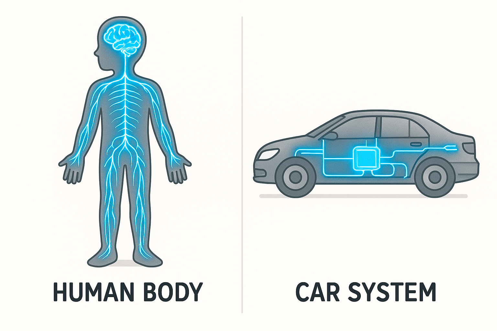
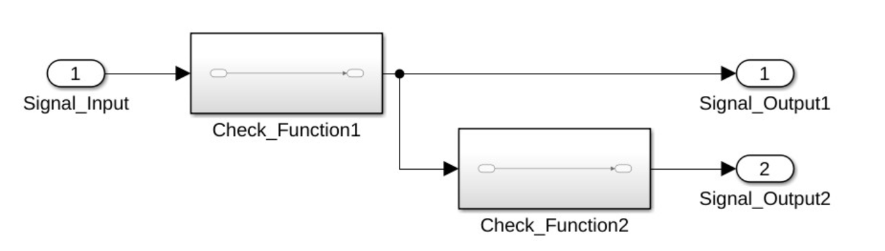

# "Who Actually Tells the Car What to Do?"

A car is a lot like the human body. Our bodies are made up of many different parts, and each one has a specific job. It is exactly the same with a car: The chassis gives the car its stability and shape. In your body, your skeleton — your bones — holds everything together. The engine pumps energy through the car, just like your heart pumps blood through you. For your heart to keep pumping, you need to eat. A car "eats" gasoline or electricity from the gas station. The wheels and tires move the car from place to place, just like your legs and feet carry you.

To make sure your body parts know when and how to do their jobs, you have a whole team of tiny nerve nodes connected to your brain through nerve pathways. The brain inside your head is the boss. It collects all kinds of information from your body, processes it, and sends commands back. For example, imagine you touch a hot stove with your finger. The nerve node in your hand instantly sends a "HOT!" signal through the nerve pathways to your brain. Without wasting a second, your brain thinks and sends back the command: "Pull your hand away immediately!"

  

    
     
    <small><em>Schematic comparison of the human body and a car. Left: Silhouette of a human body highlighting the brain and nervous system glowing in blue. Right: Silhouette of a car highlighting a blue glowing Engine Control Unit (ECU) and a wiring harness (CAN bus).</em></small>
  

So, how does this work in a car? Cars have small nerve nodes too, called Electronic Control Units — or ECUs for short. For instance, the braking ECU takes care of stopping the wheels. There are also nerve pathways inside a car: cables that run through the entire vehicle and connect the different ECUs to each other. These cables have pretty wild names, like CAN bus (the main cable in the car, similar to your spine) or LIN bus (a small, short cable, similar to the delicate nerve pathways in your fingertips). The main brain is also an ECU. In most cars, this is the Engine Control Unit. It processes information from countless sensors (the car's eyes and ears) and ensures the engine runs smoothly.

So, the ECUs tell the car what to do. But who tells the ECUs what to do? That is where software developers come in! They write instructions in a special language that tells the ECU exactly how to behave. This is called programming or coding. In the end, it takes many millions of lines of code to give the car its commands.

# "Who Decides Which Commands the Car Must Follow?"

The electronic control units (ECUs) in a car must be extremely reliable. If your brain looked at a hot stove and said, "Hot? I don't care," you would burn your hand. Cars face many similar dangers. For example, if the braking ECU suddenly forgets how to brake while you are driving fast, that is a massive problem. To make sure this never happens, there is a strict rulebook for everyone who builds cars. This rulebook is called ISO 26262.

ISO 26262 is also known as "Functional Safety" because its exact job is to ensure that errors are detected and caught before they create dangerous situations for people. The goal is for an ECU to continue working safely even if something breaks. Let’s think about our Engine Control Unit again. If the car's electronics glitch and send a faulty command like "Full throttle ahead!" to the ECU—even though you aren't pressing the gas pedal—it could cause a terrible accident. To prevent this, software developers build "guardians" into their programs. The Engine Control Unit doesn't just blindly follow the faulty "Full throttle!" signal; it double-checks with the gas pedal to see if someone is actually pressing it. If the ECU notices, "Danger, something is wrong here," it won't speed up. Instead, it immediately shuts off the engines. The car will simply come to a stop—which might be annoying if you are on your way to vacation—but at least it won't drive into a tree.

The ISO 26262 rulebook can be broken down into the following steps:

## 1. 🕵️ Assess the Risk
Experts perform what is called a Hazard Analysis and Risk Assessment (or HARA for short). This is real detective work. A group of specialists sits down together and asks: "In a specific situation, what happens if a function fails or reacts incorrectly?" and "What exact dangers will arise?" For example:

| 🕵️ Situation | ⚠️ Failure | 🛑 Hazard |
| :--- | :--- | :--- |
| Driving on a quiet residential street with children playing. | The Engine Control Unit receives a faulty "Full throttle!" signal and follows it. | Playing children could be hit by the car. |
| Driving through a city tunnel during the day. | The left headlight fails completely. | The car is difficult for other drivers to see inside the dark tunnel. |
| Trying to reverse into a tight parking space. | The backup camera displays a frozen picture showing that "the path is clear." | The car crashes into a bicycle parked behind it because the camera didn't show it. |

## 2. 🪜 Determine the ASIL (Automotive Safety Integrity Level)
Next, a "priority grade" is assigned to each risk based on how dangerous it is:

* 🔴 **ASIL D:** Extremely critical – if an error happens here, human lives are in immediate danger!
* 🟠 **ASIL C:** Very critical – it is highly difficult to maintain control of the vehicle in this situation.
* 🟡 **ASIL B:** Medium priority – if something happens here, it could get sketchy, but a good driver can usually handle it easily.
* 🟢 **ASIL A:** Low priority – the situation can be managed safely, and nothing severe will happen.
* ⚪ **QM (Quality Management):** Standard quality – this has no impact on safety (for example, the car radio).

| 🕵️ Situation | ⚠️ Failure | 🪜 Safety Classification |
| :--- | :--- | :--- |
| Residential street | Engine hits full throttle without reason. | Highly critical because the driver has no time to react: 🔴 ASIL D |
| City tunnel | One headlight fails. | Barely dangerous because the other headlight is still working fine: 🟢 ASIL A |
| Parking space | Camera shows a frozen, incorrect image. | Annoying, but if the driver moves slowly and looks over their shoulder, an accident is avoided: 🟠 ASIL C |

## 3. 🛡️ Define Safety Goals
Experts establish exactly how the system must behave during a failure to protect the driver.

| 🕵️ Situation | ⚠️ Failure | 🛡️ Safety Goal |
| :--- | :--- | :--- |
| Residential street | Engine hits full throttle without reason. | The car must never accelerate on its own. |
| City tunnel | One headlight fails. | The car must always remain visible, for example, by activating a backup light. |
| Parking space | Camera shows a frozen, incorrect image. | The system must warn the driver if the video feed is not working properly. |

## 4. 🎯 Develop Safety Mechanisms
Concrete software solutions are built (programmed) to detect and prevent these errors.

| 🕵️ Situation | ⚠️ Failure | 🎯 Safety Mechanism |
| :--- | :--- | :--- |
| Residential street | Engine hits full throttle without reason. | **Double-Check:** The Engine Control Unit only executes a "Full throttle" command if a second independent sensor agrees: "Yes, the pedal is truly pressed!"    |
| City tunnel | One headlight fails. | The control unit inside the headlight continuously runs self-checks to ensure everything is functional. |
| Parking space | Camera shows a frozen, incorrect image. | The backup camera unit detects that the image is frozen and instantly switches the screen to a solid black image to alert the driver. |

## 5. 🧪 Verification & Validation
Finally, rigorous testing proves that the safety goals have been successfully met. This testing happens across several distinct layers:

- 🟦 **Unit Testing (The "Single Part Check"):** Here, every tiny brick of the computer code is tested completely on its own.
  - *Example:* We ask a single piece of code what $2+2$ is. If it answers $4$, it passes the test. At this stage, it doesn't matter that this piece of code will later help control the brakes; we just check its basic math.
- 🧩 **Integration Testing (The "Teamwork Check"):** This layer tests how two or more blocks of computer code work together.
  - *Example:* If one code block says, "I just pressed the brake button," we check if the second code block understands this message correctly—and doesn't accidentally think it needs to turn up the radio volume.
- 🚗 **System Testing (The "Complete Vehicle Check"):** This is the ultimate test. The finished car (or the complete system) is tested exactly how it will drive on real roads.
  - *Example:* A professional test driver speeds down a closed track and slams on the brakes. We verify: Does the entire car come to a safe and controlled stop, exactly as we promised in our safety goals?

# "How Do You Write Millions of Commands Without Making Mistakes?"

Now we know there is a strict rulebook called ISO 26262. But how do we avoid losing track of everything when programming so many different electronic control units?

Imagine you want to build a massive LEGO house. You open the box, and a mountain of colorful bricks spills out onto the floor. Now, imagine if the instruction manual consisted only of text—that would be incredibly confusing! Instead, the manual is filled with pictures that show you exactly which brick goes where, step by step. In the automotive industry, we do something very similar. We don't just write lines of text; we use visual models. This is called **Model-Based Design**, or **MBD** for short.

These models look like pictures or blueprints. In programs like **MATLAB/Simulink**, we draw blocks and connect them with lines.

  

    
     
    <small><em>Example of a model. An incoming signal enters from the left ("Signal_Input") and is routed through two consecutive blocks ("Check_Function1" and "Check_Function2"). These blocks process the signal, and finally, two resulting signals are sent out to the right ("Signal_Output1" and "Signal_Output2").</em></small>
  

The incoming signals might come from the gas pedal sensor, for example. These signals then flow into a "guardian" function block, which processes the information and passes the results along.

The massive advantage of this approach is that we can simply press the "Play" button on our computer to drive the car virtually—long before the physical car is even built! This is called **Simulation**. We use it to test whether our "guardians" are paying attention and doing their jobs correctly. It is incredibly practical because it allows us to verify early on that our safety mechanisms actually work. Even better, we can automatically generate the final computer code directly from these models using specialized software tools. This ensures that no typos or manual human mistakes slip into the code.

# "Wie verhindert man ein riesiges Durcheinander bei so vielen Nachrichten?"

# "How Do You Prevent a Giant Mess with So Many Messages?"

As you can imagine, with all these signals and safety precautions, the wires inside a car are practically glowing! To prevent absolute chaos, there is a **Master Plan of Cooperation**.

In the automotive world, this plan is called an ARXML file. It acts like a massive, digital architect's handbook for the entire vehicle. Inside, it outlines exactly:

- **The Job Description:** Which program (Software Component) is responsible for what? For example: "I only take care of rolling the windows up and down."
- **The Language:** Is speed measured in "mph" or "meters per second"? The ARXML file ensures everyone uses the same units (Data Types) so that no one misunderstands each other.
- **The Connectors:** Who is allowed to talk to whom? This is just like puzzle pieces: information only flows correctly if the connectors (Interfaces) fit together perfectly.
- **The Network:** Which "cable labyrinth" (Bus System) must the messages travel through to reach their destination in the blink of an eye?

The catch is: this master plan is not a normal book. It is a digital file containing millions of lines of text. For a human to search for a mistake inside it would be like trying to find a needle in a haystack as big as a soccer stadium!

Because we cannot afford to make any mistakes (remember ISO 26262?), I built a special tool: a Python Parser. My program reads through this massive master plan in fractions of a second and instantly finds the exact spots that matter to our "safety guardians." This means we don't have to guess — we know for a fact that all the programs are working together perfectly, and the car remains completely safe.